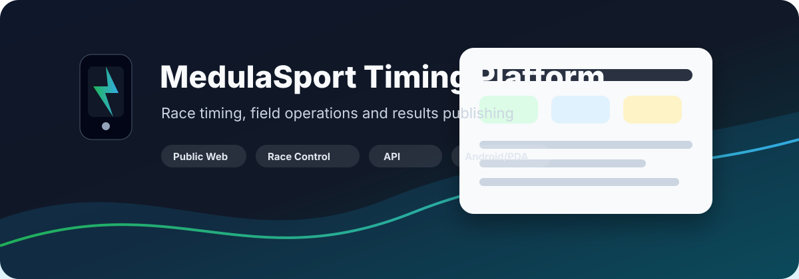
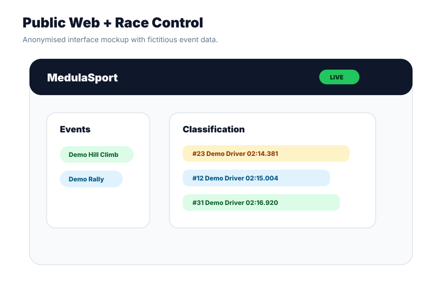
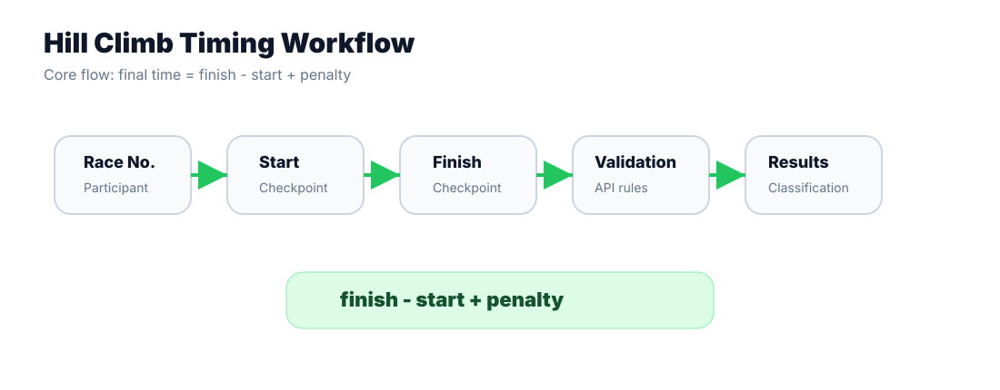

# MedulaSport Timing Platform

**Production timing and race-management system for motorsport events**




**Freelance professional project**  
**Source code is private due to client/project confidentiality.**  
[Live platform ->](https://tiempos.medulasport.com/)

---

## Context

MedulaSport needed a way to manage motorsport timing with less manual work during real events. The system had to support separate start and finish checkpoints, match times by race number, calculate results, apply penalties, manage participant authorisations and publish classifications quickly.

The operational environment also mattered: timing operators work in the field, not at a desk. Connectivity can be limited, corrections may be needed while the event is running, and a physical backup is valuable when a timestamp becomes critical.

The project started around a Hill Climb / Subida workflow and later evolved to support Rally, a more complex domain with stages, runs, checkpoints, itinerary logic and accumulated classifications.

---

## Solution At A Glance

<table>
  <tr>
    <td><strong>Public Web</strong><br />Live events, participants, timing tables, results, classifications and Rally itinerary views.</td>
    <td><strong>Race Control / Admin</strong><br />Competition setup, participant import, authorisations, timing operations, penalties, statuses and exports.</td>
  </tr>
  <tr>
    <td><strong>Backend</strong><br />REST API, validation, timing rules, corrections and PostgreSQL persistence.</td>
    <td><strong>Android / PDA</strong><br />Field app for operators, local persistence, pending synchronisation and thermal-ticket printing.</td>
  </tr>
</table>

---

## Architecture


The platform connects a public web experience, a race-control interface, a FastAPI backend, PostgreSQL persistence and an Android/PDA application used by timing operators during competitions.

More detail: [docs/architecture.md](docs/architecture.md)

---

## Visual Overview

<table>
  <tr>
    <td></td>
    <td></td>
  </tr>
</table>

Visual assets in this repository are original diagrams or anonymised mockups using fictitious data. They are not source-code screenshots and do not expose participant records or infrastructure details.

---

## Built For The Race, Not For The Office

The Android/PDA application was designed for operators working directly at checkpoints during a competition.

**Field-first UX**

- Minimal steps to register a time.
- Large touch targets and numeric race-number input.
- Time masks to reduce formatting mistakes.
- Fast finish-line capture: mark the time first, assign the race number afterwards.
- Confirmation flows before sending critical records.
- PDA-like operation for focused use in the field.

**Offline-resilient operation**

When connectivity fails, the app keeps the record locally, marks it as pending and lets the operator continue working. Pending records can be synchronised later when the connection is available again.

**Physical fallback**

The Android flow supports Bluetooth Classic thermal printers using ESC/POS, so a paper ticket can act as an operational backup during the event.

**External controls**

Some timing flows support external inputs similar to buttons or pedals through mouse-style events with debounce logic, reducing the need for complex screen interaction at the checkpoint.

More detail: [docs/android-pda.md](docs/android-pda.md)

---

## Timing Workflow



For a Hill Climb / Subida flow, the core timing model is:

```text
final time = finish time - start time + penalty
```

Each record is associated with a race number, a session or phase, a start time, a finish time, optional penalties and a sporting status. Corrections are handled through logical record versioning rather than simply destroying the previous current value.

---

## Subida -> Rally Evolution


The initial domain was comparatively direct: fixed sessions, start, finish, penalties, statuses and best-time classifications.

Rally introduced a broader model: co-drivers, stages, runs, itinerary points, checkpoints, ideal and actual times, time-card logic, neutralisations and accumulated classifications.

The important engineering story is not that the architecture was perfect; it is that a system built for a focused timing workflow was extended to support a significantly richer sporting domain without replacing the whole platform.

More detail: [docs/evolution.md](docs/evolution.md)

---

## Engineering Challenges

| Challenge | Problem | Decision | Outcome |
|---|---|---|---|
| Reliable timing with unstable connectivity | The network can fail during competition. | Combine API writes, local Android persistence, later synchronisation and paper tickets. | Operators can keep working even when connectivity is degraded. |
| Fast finish-line capture | The timestamp can be known before the race number is convenient to enter. | Allow capturing the time first and assigning the race number later. | Less friction at high-pressure checkpoints. |
| Safe corrections | Timing data can need correction during the event. | Use logical versioning for timing records. | Current results can change without treating correction as a blind overwrite. |
| Physical input devices | Operators may need a faster trigger than normal touch input. | Support external button/pedal-like inputs with debounce. | The app adapts to field hardware. |
| Hill Climb -> Rally | Rally introduced a much more complex domain. | Add a Rally-specific model for stages, runs, itinerary and controls. | The product expanded beyond the original start/finish workflow. |
| Participant imports | Updating entries should not accidentally destroy sporting data. | Update participants by race number and keep destructive deletion explicit. | Safer race administration. |
| Rally stage closure | Some competitors may be missing start or finish records when a stage closes. | Apply coherent sporting statuses based on available records. | Race control can close operational gaps consistently. |

More detail: [docs/engineering-challenges.md](docs/engineering-challenges.md)

---

## My Role

Francisco Gutierrez Beuster worked on the project as a freelance software developer. Based on the audited project material, the public case study presents the following areas of responsibility:

- Requirements analysis and functional design for a motorsport timing workflow.
- System design across web, backend, database and Android/PDA components.
- FastAPI backend and REST API implementation.
- PostgreSQL data modelling for timing, participants, phases and Rally entities.
- Public web and race-administration frontend development.
- Android/PDA app development with Kotlin and Jetpack Compose.
- API integration with Retrofit, OkHttp and Gson.
- Local Android persistence and pending-record synchronisation.
- Bluetooth thermal-printer integration with ESC/POS output.
- XLSX participant import and browser-based exports.
- Evolution from Hill Climb / Subida to Rally workflows.

Deployment, production operations and event-support responsibilities are intentionally not overstated here because this public case study only includes claims supported by the reviewed project material.

---

## Technology Stack

**Backend**

- Python
- FastAPI
- Pydantic
- PostgreSQL
- REST APIs
- JWT-based admin sessions

**Web**

- HTML
- CSS
- JavaScript
- Fetch API

**Android / PDA**

- Kotlin
- Jetpack Compose
- Material 3
- Retrofit
- OkHttp
- Gson
- Coroutines
- Android SDK

**Field hardware**

- Bluetooth Classic
- ESC/POS thermal printers

---

## Designed For Operational Reliability

The system includes several reliability-oriented decisions that are practical for live motorsport timing:

- Local Android persistence for field records.
- Pending synchronisation when connectivity returns.
- Physical tickets as an operational backup.
- Logical versioning for corrections.
- Validation of race numbers, time formats and sporting states.
- Explicit correction and administration flows.
- Application-level import/export backups.
- Network retries, timeouts and degraded/offline UI states in the web client.

This case study intentionally avoids presenting the system as high-availability infrastructure because that was not verified from the reviewed material.

---

## Public Platform

[Open the live platform ->](https://tiempos.medulasport.com/)

The live platform is linked as public context. Screenshots and diagrams in this repository use public, fictitious or anonymised information only.

---

## Confidentiality Notice

This repository is a public portfolio case study. It does not contain the proprietary source code, internal configuration, authentication material, production infrastructure details, participant records, real backups or database dumps.

See [PUBLIC_DISCLOSURE.md](PUBLIC_DISCLOSURE.md).
