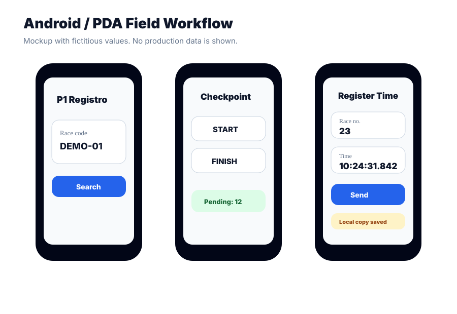

# Android / PDA Application

The Android/PDA application was designed for timing operators working in live motorsport environments.

## Technology

- Kotlin
- Jetpack Compose
- Material 3
- Retrofit
- OkHttp
- Gson
- Coroutines
- Android SDK
- Bluetooth Classic
- ESC/POS thermal printing

## Main Flows

### Race Selection

The operator enters a race code. The app loads the race configuration and routes the operator into the correct workflow.

### Hill Climb / Subida

The operator selects a checkpoint type, usually start or finish, then selects the phase and records race numbers and times.

### Rally

The operator selects an itinerary point and uses a mode designed for the role at that checkpoint. Finish-line flows support capturing timestamps first and assigning race numbers afterwards.

### Offline-Resilient Operation

When the API cannot be reached, the app stores the record locally and marks it as pending. The operator can continue working and synchronise pending records later.

### Printing

The app can print compact tickets through Bluetooth thermal printers using ESC/POS. This provides a physical operational backup for critical timing records.

## Field UX Decisions

- Numeric input for race numbers.
- Time masks to reduce formatting errors.
- Large action buttons.
- Confirmation before critical actions.
- Fast capture of finish times.
- Pending-record indicators.
- External button/pedal-like input support with debounce.

## Visual Mockup

The mockup uses fictitious data and does not expose production information.
