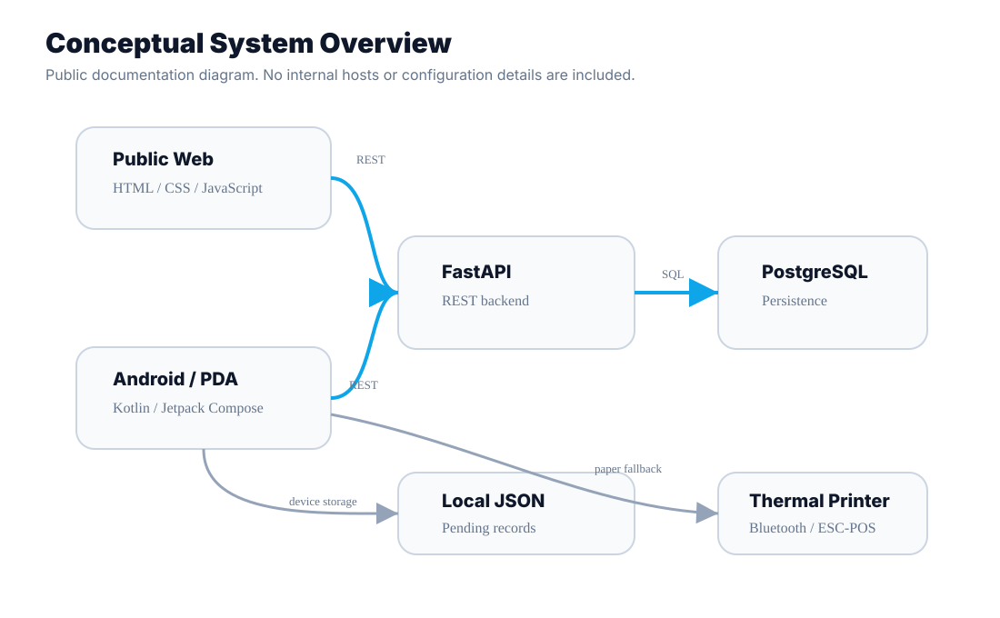

# Architecture

MedulaSport is composed of four main product surfaces: a public web platform, a race-control interface, a FastAPI backend and an Android/PDA application used by timing operators.

## Components

### Public Web

The public web interface exposes event information, participant views, timing tables, results, classifications and Rally-specific views such as stages and itinerary.

It is implemented as a static frontend using HTML, CSS and JavaScript. The browser communicates with the backend through REST requests.

### Race Control / Admin

The administrative interface supports competition setup, participant import, authorisations, timing actions, penalties, statuses, exports and Rally configuration.

It shares the same web delivery model but uses authenticated admin actions for operational tasks.

### Backend

The backend is a FastAPI REST API responsible for validation, timing rules, corrections, participant management, Rally logic and PostgreSQL persistence.

The timing model includes logical versioning so corrections can update current results without treating every change as a destructive overwrite.

### Android / PDA

The Android application is used directly at timing checkpoints. It communicates with the API, stores local records when needed and supports Bluetooth thermal printing.

## Data Flow

1. Race control configures competitions and participants.
2. Timing operators use Android/PDA devices at checkpoints.
3. Records are sent to the API when connectivity is available.
4. If the connection fails, records remain local and can be synchronised later.
5. The backend validates and stores records in PostgreSQL.
6. Public and admin web views read calculated results from the API.

## Publication Boundaries

This public case study intentionally avoids implementation code, internal infrastructure identifiers, production configuration and private operational data.
