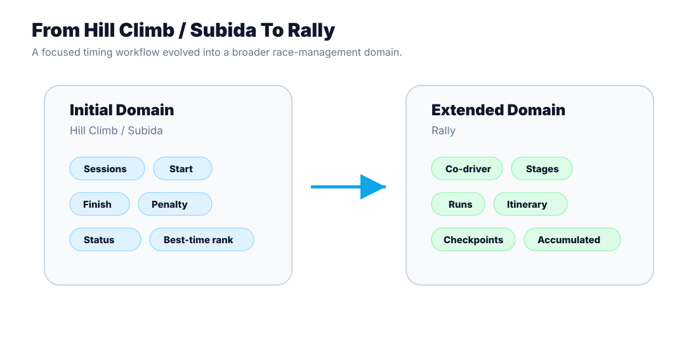

# Evolution: Hill Climb / Subida to Rally

## Initial Domain: Hill Climb / Subida

The original timing flow focused on a direct motorsport timing problem:

- Fixed sessions.
- Start checkpoint.
- Finish checkpoint.
- Race number matching.
- Penalties.
- Sporting statuses.
- Best-time classification.

This domain is operationally demanding but conceptually direct: pair a start and finish time, apply penalties and sort results.

## Extended Domain: Rally

Rally introduced a more complex structure:

- Co-drivers.
- Stages.
- Runs.
- Itinerary points.
- Checkpoints.
- Ideal and actual times.
- Time-card behaviour.
- Neutralisations.
- Accumulated classifications.
- Stage closure rules.

## Engineering Implication

The project evolved from a start/finish timing workflow to a broader race-management system. The Rally model was added as a specific extension instead of forcing all Rally concepts into the simpler Hill Climb phase model.

This is the central product story: the system adapted to a more complex domain while preserving the existing platform direction.
